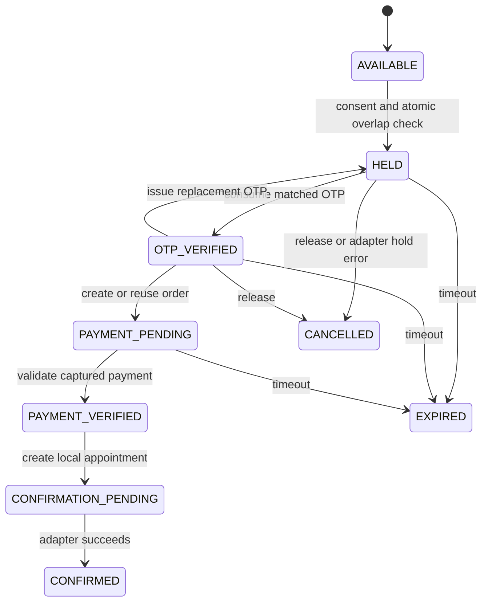
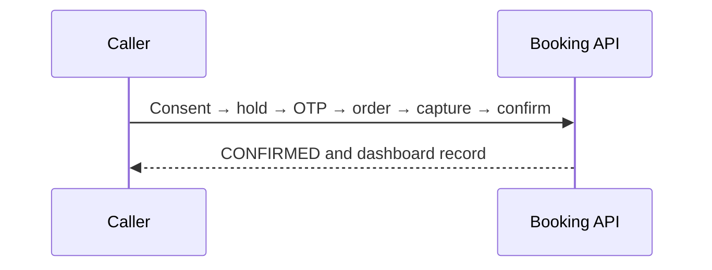
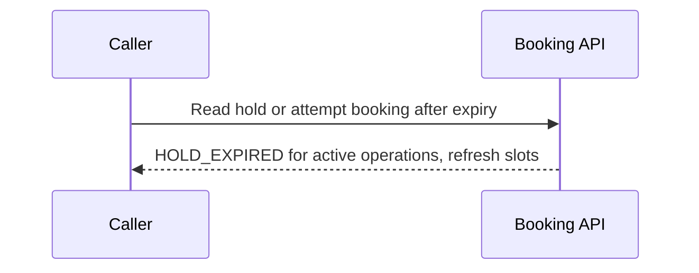
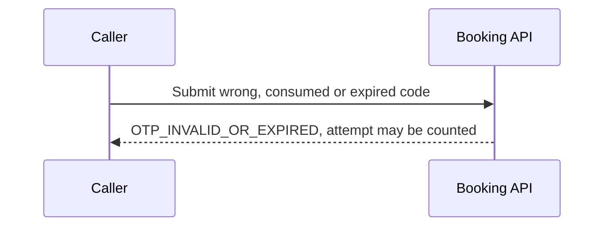
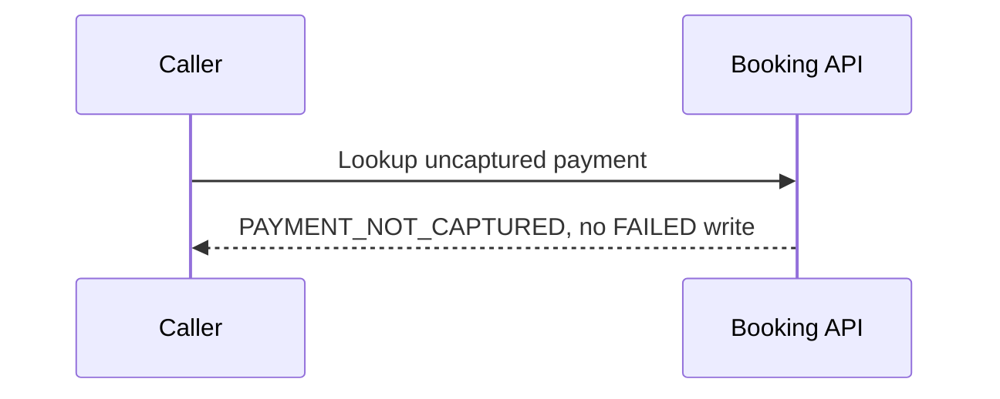
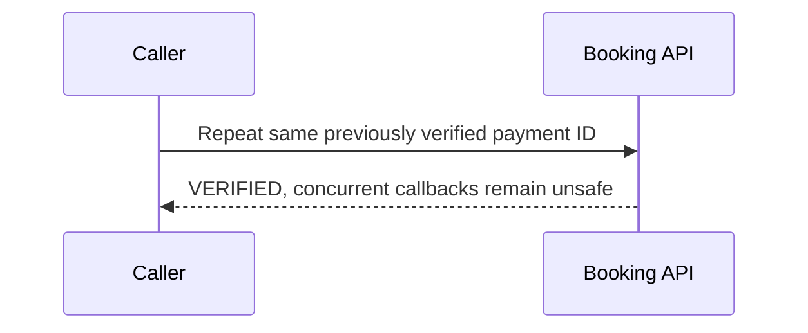
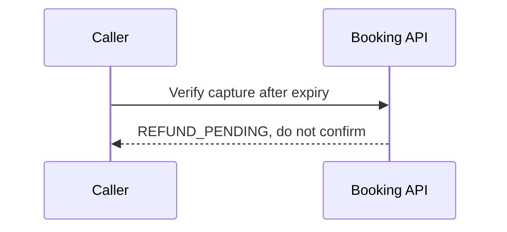
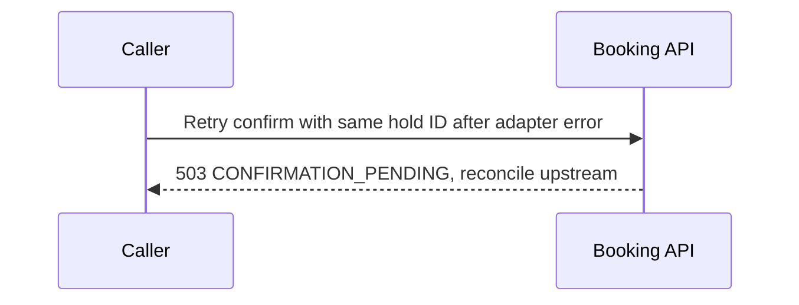
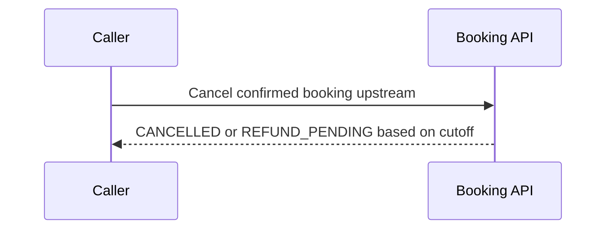
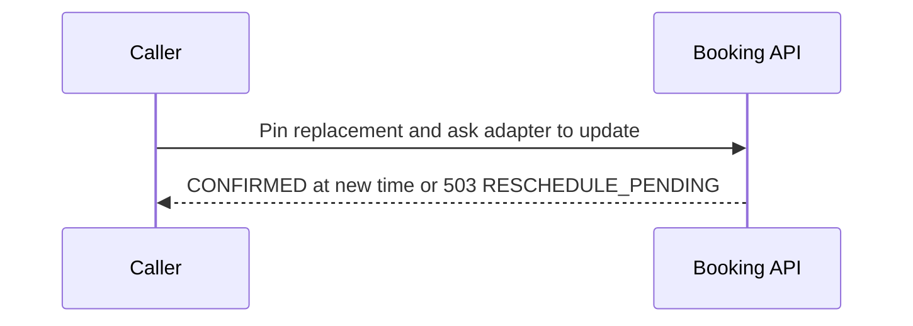

# Booking state machine

The combined shared BookingStatus enum contains AVAILABLE, HELD, OTP_VERIFIED, PAYMENT_PENDING, PAYMENT_VERIFIED, CONFIRMATION_PENDING, CONFIRMED, EXPIRED, CANCELLED, PAYMENT_FAILED, REFUND_PENDING and REFUNDED. PaymentStatus contains CREATED, VERIFIED, FAILED, REFUND_PENDING and REFUNDED. Enum membership does not imply a reachable stored state.

Reconciliation jobs have internal PENDING, RUNNING, DONE and MANUAL states. A lease expiry permits another worker to retry a provider lookup. Applying verified evidence uses the existing booking or payment transition. A pending reschedule guard quarantines the replacement slot after its hold expires and until authoritative evidence resolves the operation. The worker does not release reservations on retry exhaustion.

| Domain | Transitions, conditions and recovery |
|---|---|
| Session | Express creates an active session for a known clinic. Requests require both headers and an unexpired record. After 24h calls fail with SESSION_REQUIRED. Recreate for new journeys; existing ownership does not transfer. |
| Hold | Engine creates HELD after consent and availability recheck. Expiry is immediate for capacity, even before state cleanup. Default 300 seconds. Cleanup marks HELD, OTP_VERIFIED and PAYMENT_PENDING expired. Release can be repeated while eligible; mock hold may remain busy until expiry. |
| OTP | Engine issues a code valid for 180 seconds, with a 60s resend limit. Matching phone/hold/session can consume once. Failed matching attempts increment count up to five. Resend replaces the verifier and clears the previously verified phone. Expired hold wins over OTP TTL. |
| Payment | Payments writes CREATED on successful order and sets the hold PAYMENT_PENDING. Requires active hold, consent and OTP. Capture verification accepts matching signature, provider ID, order, amount, currency and captured status. It writes VERIFIED or REFUND_PENDING for expired/cancelled holds. Duplicate matching payment can return VERIFIED instead of PAYMENT_VERIFIED. Uncaptured and rejected values do not write FAILED. |
| Appointment | Engine inserts CONFIRMATION_PENDING after consent, phone and payment checks. This reserves capacity. Successful adapter response writes CONFIRMED and records outbox/audit. On adapter error keep pending and retry with same hold ID. An expired upstream hold can prevent recovery. |
| Refund | Engine marks payment pending on late capture, expiry at confirm entry after verification, or eligible cancellation. Cancellation uses clinic cutoff hours. No transition to REFUNDED is implemented. Non-refundable cancellation leaves payment VERIFIED and appointment CANCELLED. |
| Reschedule | Requires confirmed booking, owned active replacement, same doctor/service and equal fee. Engine pins replacement for 24h during adapter update. On success replace local times and consume replacement; on error retain original and reconcile pending upstream change. The implementation lacks durable mutual exclusion and an unused-hold guard. |

`PAYMENT_FAILED`, `FAILED` and `REFUNDED` have no ordinary write path. Concurrent callback and appointment mutations can violate the intended transition order. See [backend risks](BACKEND_INTEGRATION.md).

## Successful booking

## Expired hold

## Failed OTP

## Failed payment

## Duplicate callback

## Late capture

## Confirmation failure

## Cancellation and refund

## Rescheduling

